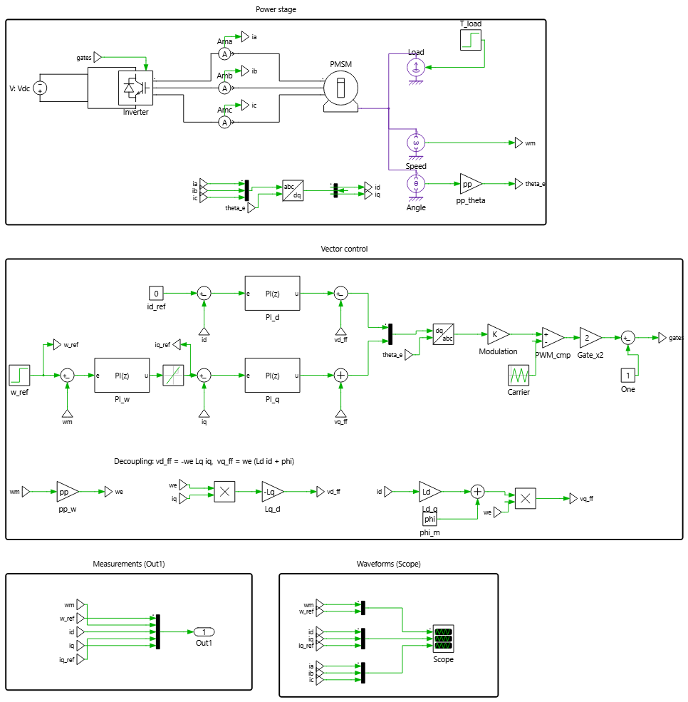
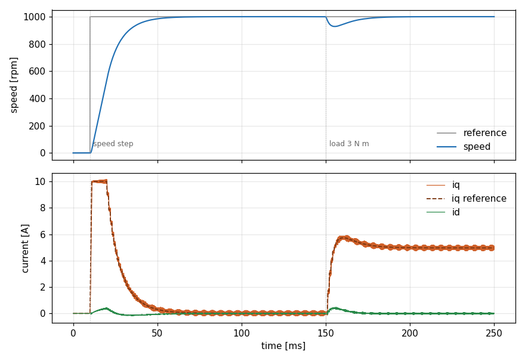

# 実例：PMSMのベクトル制御（ゼロから生成）

既存のモデルを編集するのではなく、カタログの部品だけで `.plecs` を一から生成した最初の例です。

## ファイルの系譜

| ファイル | 作り方 | 内容 |
|---|---|---|
| `pmsm_foc.plecs` | `make_pmsm_foc.py` で生成したあと、人がPLECS上で部品の向き（インバータ、電流計、dq2abc）と配線の経路を直した | 動作は生成時のまま |
| `pmsm_foc_v2.plecs` | `make_pmsm_foc_v2.py`（`pmsm_foc.plecs` を編集） | PWMを三角波とコンパレータに置き換えた。Scopeを追加した（速度、dq電流、相電流の3軸） |
| `pmsm_foc_v3.plecs` | `make_pmsm_foc_v3.py`（v2を編集） | PI制御器3つを離散PIに置き換えた。電流制御は100 µs（PWM周期）、速度制御は1 ms、後退オイラー。ゲインはv2と同じ |

`make_pmsm_foc.py` は再実行しないでください。人が直した向きが消えます（`Model.write` は既存のファイルを上書きしないので、そのままではエラーで止まります）。



PLECSで `pmsm_foc_v2.plecs` または `pmsm_foc_v3.plecs` を開いてシミュレーションを実行し、Scopeを開くと波形を確認できます。

## 構成

| 部分 | 内容 |
|---|---|
| 主回路 | 直流300 V → 2レベルIGBTインバータ → PMSM（4極対、Rs 0.62 Ω、Ld = Lq = 4.14 mH、φ 0.101 Wb、J 1e-3 kg·m²。PLECSのデモ `boosted_motor_drive` と同じ定数） |
| 速度制御 | PI制御器（帯域50 Hz）。出力は±10 Aで制限し、q軸電流指令にする。指令の変化率は1e4 A/sに制限する |
| 電流制御 | d軸、q軸それぞれのPI制御器（帯域1 kHz。PIの零点で固定子の時定数L/Rを打ち消す）。id = 0 制御。非干渉化のフィードフォワード付き |
| 変調 | dq → abc → 変調率（2/Vdc倍）→ 三角波比較PWM（10 kHz） |
| 試験 | t = 10 ms に 0 → 1000 rpm の速度ステップ、t = 150 ms に 3 N·m の負荷トルク |

ゲインと試験条件は、すべて初期化コマンドの変数です。ブロックが直接参照している変数（`Kp_w`、`Ki_i`、`diq_max` など）なら、`ModelVars` で変えられます。`wc_w` のような計算元の変数を変えても、ゲインは再計算されません。

## 使い方

コマンドはこのフォルダで実行します。

```
python make_pmsm_foc_v2.py                # pmsm_foc.plecs から pmsm_foc_v2.plecs を作る
python run_pmsm_foc.py pmsm_foc_v2        # シミュレーションと評価値の計算（約3秒）
python run_pmsm_foc.py Kp_w=1.04 Ki_w=163 # ゲインを変えて試す
python plot_pmsm_foc.py pmsm_foc_v2       # results/pmsm_foc_v2_waveforms.png
python -m plecs_ai.snapshot pmsm_foc_v2   # results/pmsm_foc_v2.png（回路図）
python make_pmsm_foc_v3.py                # v2 から pmsm_foc_v3.plecs（離散PI）を作る
python run_pmsm_foc.py pmsm_foc_v3
```

`plot_pmsm_foc.py` だけは matplotlib が必要です。

## 結果


下の表は最初の版（`pmsm_foc.plecs`）の値です。v2もほぼ同じです。

| 項目 | 値 |
|---|---|
| 速度ステップの立ち上がり（10〜90 %） | 18.9 ms（q軸電流が10 Aの制限に張り付いて加速するため） |
| オーバーシュート | 0 % |
| 整定時間（1 %以内） | 38 ms |
| 負荷投入時の速度の落ち込み | 7.2 rad/s（6.8 %） |
| 回復時間（1 %以内） | 28 ms |
| 負荷時のq軸電流 | 4.966 A（理論値 (T + F·ω)/Kt = 4.968 A） |
| d軸電流 | 平均 0.0002 A、最大 0.47 A |

## 離散PI（v3）と連続PI（v2）の比較

| 項目 | v2（連続） | v3（離散） |
|---|---|---|
| 立ち上がり（10〜90 %） | 18.9 ms | 20.8 ms |
| 整定時間（1 %以内） | 38.2 ms | 44.1 ms |
| 負荷投入時の速度の落ち込み | 6.83 % | 7.21 % |
| 回復時間 | 27.6 ms | 27.3 ms |
| 負荷時のq軸電流 | 4.970 A | 4.968 A |



連続のときに決めたゲインのままで動いた。サンプリングとホールドの遅れの分だけ、速度の応答がわずかに遅くなっている。q軸電流指令は速度制御の周期（1 ms）ごとの階段になる。

## 作る過程で分かったこと

- **部品の規約を先に試験で確かめた。** dq変換の向き、インバータのゲート値の意味、PMSMの逆起電力の向き、PWMの入力範囲を `tests/block_tests.py` で確かめてから組んだ。その結果、モデルは初回の読み込み・初回のシミュレーションで正しく動いた。
- **速度制御の帯域を20 Hzから50 Hzに上げた。** 20 Hzでは負荷投入時の速度の落ち込みが16.9 %、回復に88 msかかった。慣性が小さいので帯域を上げられる。`ModelVars` で試してから既定値を変えた。
- **q軸電流指令に変化率の制限を入れた。** 制限が無いと、速度ステップの直後に電流PIの比例項（26 × 10 A = 260 V）が電圧制限（150 V）で飽和し、約10 msの間、q軸電流が指令より最大1 A低くなった。PIの零点で打ち消していた極（L/R = 6.7 ms）が、飽和で積分器の値がずれたときに遅れとして現れるためである。電圧制限を一時的に400 Vにすると遅れが消えることで確かめた（−1.04 A → −0.06 A）。
- **負荷トルクの向き**：`ControlledTorque` は正の入力で軸を加速させる。負荷には −T_load を与えている。

## 未確認・今後

- v1の `Symmetrical_PWM` の `sampling` は1（ナチュラル、キャリア波形開始：中間値）だった。v2の三角波とコンパレータでも、評価値はほぼ同じだった（負荷時のq軸電流 4.970 A、速度の落ち込み 6.83 %）。
- 電流制御は連続時間のPIである。実機に合わせるなら、離散時間のPI（`Discrete_PID_Controller`）とサンプリングの遅れを入れる。
- 弱め界磁、デッドタイム、空間ベクトル変調は入れていない。
